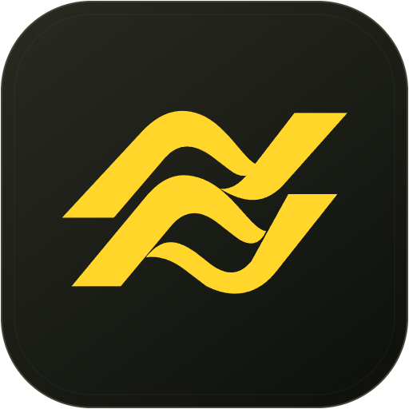
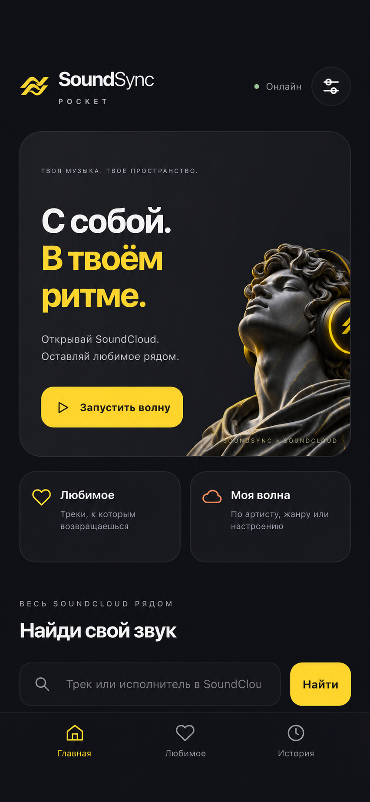
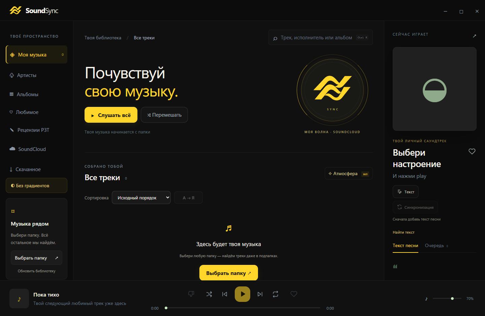

<h1>SoundSync</h1>

Твоя музыка. Твои тексты. Твой ритм.

Музыкальный плеер для Windows и macOS Apple Silicon. Мобильная версия — веб-приложение SoundSync Pocket.

<a href="#скачать-soundsync">Windows и Mac</a> · <a href="#soundsync-на-iphone">Установить на iPhone</a> · <a href="https://github.com/Genovide/SoundSync/issues">Сообщить о проблеме</a>

## Скачать SoundSync

**Первый запуск:** скачай полную сборку **1.2.0**, затем установи один последний апдейт **1.2.9**. Промежуточные обновления не нужны.

| Система | ① Полная сборка — для первой установки | ② Последний накопительный апдейт |
|---|---|---|
| **Windows x64** | [Скачать полный ZIP](https://github.com/Genovide/SoundSync/releases/download/v1.2.0/SoundSync-1.2.0-Windows-x64.zip) | [Скачать апдейт 1.2.9](https://github.com/Genovide/SoundSync/releases/download/v1.2.9/SoundSync-1.2.9-Update-Windows-x64.zip) |
| **macOS 14+, Apple Silicon** | [Скачать DMG](https://github.com/Genovide/SoundSync/releases/download/v1.2.0/SoundSync-1.2.0-macOS-arm64.dmg) · [Полный ZIP](https://github.com/Genovide/SoundSync/releases/download/v1.2.0/SoundSync-1.2.0-macOS-arm64.zip) | [Скачать апдейт 1.2.9](https://github.com/Genovide/SoundSync/releases/download/v1.2.9/SoundSync-1.2.9-Update-macOS-arm64.zip) |

**Уже установлен SoundSync?** Скачай только апдейт своей системы и установи поверх существующей версии. Он включает все изменения предыдущих обновлений, в том числе поддержку прежнего названия плеера. Музыка, настройки и история сохраняются.

[Описание последнего апдейта](https://github.com/Genovide/SoundSync/releases/latest) · [Постоянный релиз с полными сборками](https://github.com/Genovide/SoundSync/releases/tag/v1.2.0)

Полная сборка включает Python, FFmpeg и модель синхронизации. Пользовательской музыки, настроек, истории и ключей в ней нет. Обычно загружается только небольшой апдейт; при несовместимой или неполной основе установщик докачает необходимые компоненты с проверкой SHA-256. Контрольные суммы опубликованы в релизах.

## SoundSync на iPhone

**[Открыть SoundSync Pocket](https://soundsync-pocket.carvedbasil3.chatgpt.site)** — отдельная мобильная веб-версия с поиском SoundCloud, случайными треками, «Моей волной», любимым и историей. Открывается по ссылке и устанавливается на главный экран; скачивать настольную сборку и апдейт не нужно.

  

### Как установить

1. Открой [ссылку на SoundSync](https://soundsync-pocket.carvedbasil3.chatgpt.site) **в Safari**. Если ссылка открылась внутри Telegram или другого приложения, выбери **«Открыть в Safari»**.
2. Нажми **«Поделиться»** — значок квадрата со стрелкой вверх.
3. Прокрути список действий и выбери **«На экран “Домой”»**.
4. Оставь название **SoundSync**.
5. Если есть переключатель **«Открывать как веб-приложение»**, включи его.
6. Нажми **«Добавить»** в правом верхнем углу.
7. На главном экране появится иконка SoundSync. Нажми на неё — приложение откроется в отдельном окне.

**Для прослушивания нужен интернет.** Любимое и история сохраняются на этом устройстве и не синхронизируются с настольной версией. Громкость на iPhone регулируется кнопками телефона или через Пункт управления. Доступа к медиатеке Apple Music и автоматической синхронизации текстов в этой веб-версии пока нет.

## Возможности

- Карточка трека: свои метаданные и обложка, выбор данных LRCLIB, отмена правок.
- Мини-плеер: открой кнопкой при наведении на обложку в нижней панели. Esc возвращает основное окно без остановки музыки.

- Медиатека, альбомы, артисты, любимые и скачанные треки.
- SoundCloud и «Моя волна» по артисту, жанру или настроению.
- LRCLIB: поиск и сохранение текстов, уточнение названия, исполнителя и альбома.
- Разбор сложных названий и версий записей; ручные правки сохраняются по ID трека.
- Синхронизация слов и ручная правка таймингов. У slowed/sped-up записей таймкоды оригинала не применяются автоматически.
- Рецензии и оценки РЗТ в собственном окне плеера.
- Бесконечная прокрутка и сортировки по названию, исполнителю, альбому, длительности и году.
- Чёрно-жёлтое оформление SoundSync, режим без градиентов и визуализации.

### Windows

Распакуй полный ZIP целиком и запусти `SoundSync.exe`. `Create-SoundSync-Shortcuts.bat` создаёт ярлыки. Данные хранятся в папке `Data` рядом с программой.

Для обновления закрой плеер, распакуй Update ZIP в отдельную папку и запусти `Update-SoundSync.bat`. Выбери установленный плеер. Обновление проверяет файлы и создаёт резервную копию; пользовательские данные сохраняются.

### macOS

Нужны Apple Silicon и macOS 14+. Открой DMG и перенеси `SoundSync.app` в Applications. Данные хранятся в `~/Library/Application Support/SoundSync`.

Mac-сборка тестовая: она имеет ad-hoc подпись, но не нотарифицирована Apple. Gatekeeper может ограничивать открытие. Защиту системы отключать не нужно; для обычного публичного распространения без этих ограничений требуется Developer ID и нотариализация.

Update ZIP 1.2.9 обновляет установленную версию, включая прежнюю portable-сборку. Совместимая основа сохраняется; недостающая загружается автоматически. Приложение становится `SoundSync.app`; локальная ad-hoc подпись восстанавливается системным codesign. Закрой приложение через меню SoundSync и запусти `Update-SoundSync.command`. Данные прежней portable-сборки копируются в `Application Support/SoundSync`, если профиля SoundSync ещё нет. Существующий профиль не заменяется. Для устаревшей основы нужен интернет и место для резервной копии.

## Примечания

Один трек бывает в нескольких изданиях: проверяй выбранный альбом LRCLIB. Сайт РЗТ может запрашивать проверку браузера. AI-описания запускаются пользователем с личным ключом OpenRouter; ключи в сборки не включаются.

## Лицензии

Лицензии сторонних компонентов собраны в [отдельном списке](licenses/README.md) и относятся к соответствующим компонентам. Лицензия собственного кода SoundSync отдельно не объявлена; MIT-лицензия Electron не обозначает лицензию всего SoundSync.

## Сборка из исходников

`app` — приложение, `alignment` — Python-обработчики, `scripts` — упаковка и проверки.

Mac: Node.js 22+, npm, uv, инструменты Xcode. `npm ci`, `npm ci --prefix app --omit=dev`, `npm run build:mac`, `npm run test:mac`, `npm run archive:mac`. GitHub Actions выполняет нативную сборку и сохраняет отчёт запуска и скриншот.

Windows: укажи `SOUNDSYNC_WINDOWS_BASE` на полную portable-версию с Python и моделью и выполни `npm run build:windows`. Папка `Data` в архив не включается.

## Мобильная веб-версия

[Открыть SoundSync Pocket](https://soundsync-pocket.carvedbasil3.chatgpt.site) · [Установка на iPhone](#soundsync-на-iphone) · [Исходники PWA](pwa/README.md).

Инструкции по локальному запуску и самостоятельному размещению экспериментальной веб-версии находятся в [pwa/README.md](pwa/README.md).
